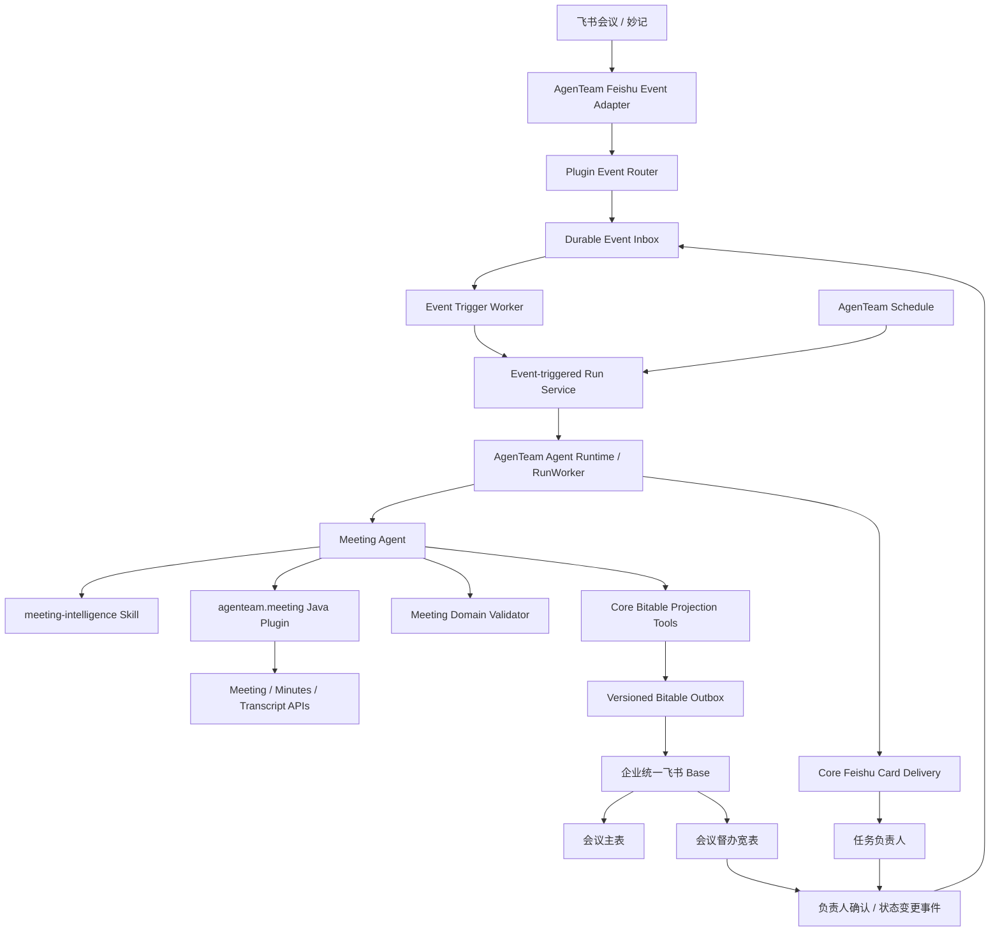

# agenteam.meeting 架构基线

- 状态：**Accepted**
- 确认日期：2026-11-10
- 目标插件：agenteam.meeting
- 目标仓库：neilyoli/agenteam
- 适用范围：会议订阅、纪要理解、任务识别、统一督办数据、负责人确认、持续跟进与跨会议覆盖分析。
- 实施原则：先完成 M0 审计和 POC；本文档不授权直接跳过架构验证进行生产代码改造。

---

## 1. 背景与目标

本次不是将 magic-ai/ruoyi-meeting 原样搬进 AgenTeam，而是把会议领域能力提取为 agenteam.meeting 插件，并利用 AgenTeam 已有的 Agent Runtime、插件、Skill、Run、飞书集成、消息通知和 Schedule 能力完成重构。

### 1.1 目标

1. 订阅企业指定范围内的飞书会议事件。
2. 会议结束后获取会议元数据、智能纪要、Minutes 和可用逐字稿。
3. 由 Meeting Agent 判断会议内容、提取行动任务、识别 L1/L2/L3、关联上下游会议。
4. 将会议与任务投影到企业统一飞书 Base。
5. 向任务负责人发送确认卡片，处理确认、调整和拒绝。
6. 通过定时 Agent Run 持续跟进逾期、未确认事项和上游任务覆盖情况。
7. 所有事件和外部写入可恢复、可审计、可幂等，不因重复事件、服务重启或 API 暂时失败产生重复业务记录。

### 1.2 非目标

- 不复制 AgenTeam 的 Agent Runtime、Run/Turn、Token 统计、Skill Runtime 或插件 Worker。
- 不把 LangChain4j Agent、RuoYi Controller、Redis MeetingProcessSession 搬进插件。
- 不为每场会议创建独立 Base。
- 不在插件 JVM 进程中常驻飞书 WebSocket、定时线程、数据库连接池或后台 Worker。
- 不再维护一份与飞书督办宽表并行的 meeting_task 业务状态库。
- 不将所有会议处理步骤固化成固定工作流节点。
- 不允许 Agent 自行指定任意 App Token、Table ID、飞书字段名或越权执行写操作。

---

## 2. 当前仓库能力审计

本节记录的是对当前 main 分支代码的静态审计结论。实施前仍需对目标分支重新核验，代码始终是事实基准。

### 2.1 AgenTeam 已有能力

| 当前能力 | 代码位置 | 本次复用方式 |
| --- | --- | --- |
| Java 工具插件 API | agenteam-server/agenteam-plugin-api 中的 JavaToolPlugin | Meeting 插件实现现有接口 |
| 插件单次独立进程 | service/plugin/javaworker 中的 JavaPluginProcesses、JavaPluginWorker | 保持无状态工具调用模型 |
| 插件配置与凭据上下文 | JavaPluginContext | 使用受限凭据；凭据生命周期由 Core 管理 |
| Feishu WebSocket / Webhook | service/chat/provider/feishu 中的 FeishuConnectionProvider、ChatWebhookService | 复用官方协议、帧编解码和验签；抽象通用事件入口 |
| 长连接租约管理 | service/chat/ChatConnectionManager | 借鉴租约、续约和断连恢复；不得把会议事件硬塞进聊天业务 |
| 入站事件持久化 | service/chat/ChatIngressService | 借鉴先持久化、后 ACK 的原则 |
| 飞书身份、应用和 Token 管理 | service/integration/feishu | 扩展最小权限的会议资料授权能力 |
| 飞书消息发送与卡片 | FeishuIntegrationProvider、FeishuMessageCards | 复用渠道层，补齐通用业务卡片投递与回调路由 |
| Skill 版本冻结 | service/skill/SkillExecutionService | Meeting Agent 固定引用发布的 Skill 版本 |
| Run 提交与后台执行 | RunSubmissionService、RunWorker | Event-triggered Run 进入既有执行链 |
| 定时操作注册 | service/schedule/ScheduleActionRegistry | 扩展会议跟进操作，复用调度和执行记录 |

### 2.2 当前能力缺口

当前 JavaToolPlugin 只声明工具并处理单次调用，不包含长期事件订阅接口。JavaPluginContext 的凭据也只在单次调用中提供。JavaPluginPackageReader 当前解析的清单字段主要是插件身份和 configurationSchema，尚无事件订阅声明。

当前飞书连接管理主要围绕聊天机器人、消息接收和卡片回调。它不是一个已经完成的通用会议事件总线。不得把现有 ChatIngressService 当成会议事件的业务存储，也不得把 ChatConnectionManager 直接视为会议事件订阅能力已经完成。

当前 Feishu Integration Provider 主要覆盖企业应用接入、身份授权和消息发送；当前 main 未发现可直接用于会议插件的通用 Bitable Binding / Schema / Outbox 服务。该能力需要在 Core 层新增或抽象。

因此需要补齐的 Core 能力为：

1. 插件事件订阅声明与企业级订阅实例。
2. 通用事件 Inbox、投递记录、租约 Worker 和事件触发 Run。
3. 明确的企业级系统执行身份，不冒充会议主持人或普通用户。
4. 通用 Bitable Binding、Schema 校验、字段映射、Outbox 和回写/对账。
5. 面向业务卡片的通用投递、签名回调、操作者校验与幂等。
6. 可刷新、可撤销、按 API 范围授权的飞书会议资料 Credential Broker。

### 2.3 magic-ai 领域资产审计

参考代码来源：

- neilyoli/magic-ai：feature/meeting-base-dynamic-schema-projection
- neilyoli/magic-ai：feature/meeting-agent-v2-aily-orchestrator-v2
- neilyoli/magic-ai：feature/meeting-record-feishu-sync

| 原有能力 | 新归属 | 处理结论 |
| --- | --- | --- |
| 会议结束事件与订阅匹配 | AgenTeam Event Adapter + Meeting Subscription | 提取事件语义，重写通用订阅 |
| 会议 / Note / Minutes / Transcript 获取 | agenteam.meeting | 保留业务能力，改为受控 Java API Tools |
| 任务候选提取 | Meeting Agent + meeting-intelligence Skill | 保留规则和提示知识，重新组织 |
| 逐字稿证据定位 | Meeting Domain Validator / Skill | 保留，作为正式任务的证据约束 |
| 任务合并与去重 | Meeting Domain Service | 保留算法，重新定义稳定 task key |
| 负责人解析 | Meeting Plugin + Core Directory / Identity | 保留，不能仅按姓名猜测 |
| 上下游会议发现与覆盖分析 | Meeting Plugin + Meeting Agent | 保留，改为跨会议查询能力 |
| 动态 Base Schema 投影 | AgenTeam Bitable Projection Service | 参考其动态 Schema 思路，统一实现 |
| Redis MeetingProcessSession | 无 | 淘汰，不迁移旧固定流程 Session |
| 每场会议独立 Base | 无 | 淘汰，改为企业统一 Base |
| 旧 Meeting Task / 多套 Outbox | AgenTeam 通用 Outbox | 整理为统一可靠投影链 |

### 2.4 ERP 产品研发宽表同步审计

参考 neilyoli/erp-middle-center 分支 feat_neilyo_feishu_sync，重点实现包括：

- FeishuSyncBindingDO：目标 Base / Table、业务类型、字段映射、结果回写和绑定管理。
- FeishuProductDevFieldEnum：业务字段白名单、字段类型与唯一键约束。
- ProductDevFieldConverter：显式字段转换，拒绝不支持的类型。
- FeishuSyncLogDO：同步状态、业务入库标记、回写标记、错误与人工重试。
- FeishuSyncBusinessService：业务本地事务与完成标记一起提交，飞书网络请求不包在本地事务中。
- FeishuSyncExecuteService：条件领取、幂等重试、已入库后只补回写。
- framework-base/feishu：通用 Bitable SDK 操作、字段映射和记录读写。

复用的是 Binding、字段白名单、类型转换、业务唯一键、执行日志、失败恢复和结果回写的设计思想，不直接依赖 ERP 的 PLM DTO、租户框架或产品研发业务枚举。

会议同步方向与产品研发不同：会议数据由 Agent 写入飞书，负责人后续在飞书维护状态；因此必须补充可靠的出站投影和入站变更对账。

---

## 3. 架构决策记录

以下决策作为本次确认的架构基线。

| ADR | 决策 | 结论 |
| --- | --- | --- |
| MTG-ADR-001 | 插件执行模型 | agenteam.meeting 使用现有 JavaToolPlugin 单次独立进程；不运行长期服务 |
| MTG-ADR-002 | 事件订阅归属 | 订阅、事件连接、Inbox、Worker 和事件触发 Run 归 AgenTeam Core |
| MTG-ADR-003 | Agent 执行模型 | 一个 Meeting Agent，使用 AgenTeam 当前 Agent Runtime 和 Run/Turn 记录 |
| MTG-ADR-004 | Skill 管理 | meeting-intelligence 为核心 Skill；版本随 Agent 发布并冻结到 Run |
| MTG-ADR-005 | 飞书数据布局 | 一个企业统一 Base，含会议主表和会议督办宽表 |
| MTG-ADR-006 | 任务事实来源 | 飞书督办宽表是任务业务状态唯一事实来源 |
| MTG-ADR-007 | 任务唯一键 | meeting_key 和 task_key 稳定；重复分析必须复用已存在 task key |
| MTG-ADR-008 | 同步模式 | Binding + Schema 校验 + 字段白名单 + Versioned Outbox + 幂等 Upsert |
| MTG-ADR-009 | 会议流程 | 事件驱动 + Agent 自主决策；不迁移旧 MeetingProcessStage 固定状态机 |
| MTG-ADR-010 | 人工确认 | 飞书卡片回调由 Core 验签、鉴权、幂等；确认结果回写统一督办宽表 |
| MTG-ADR-011 | 系统身份 | 事件触发使用企业级服务身份，不冒充主持人、负责人或创建订阅的管理员 |
| MTG-ADR-012 | 业务规则 | L1/L2/L3、证据、身份和写入约束保留为 Skill 指导 + Java Validator 硬约束 |

---

## 4. 目标架构

### 4.1 组件关系



### 4.2 职责边界

| 层 | 负责内容 | 明确不负责 |
| --- | --- | --- |
| AgenTeam Core | 飞书连接、验签、事件订阅、Inbox、Worker、Run、权限、Token、Bitable Binding/Outbox、卡片通知、Schedule | 会议任务语义、L1/L2/L3 领域规则 |
| agenteam.meeting | 会议 / 纪要 API 工具、参会人和负责人解析、会议领域数据规范化、任务证据和领域校验 | 常驻监听、独立 Agent Runtime、独立业务任务状态库 |
| Meeting Agent | 理解会议、规划工具调用、判断任务、识别风险、决定是否需要补充上下文、形成结构化结果 | 直接拼接任意飞书字段 payload、越权授权、绕过 Validator |
| Skills | 分类规则、证据政策、去重策略、负责人政策、上游覆盖分析和输出规范 | 代替权限校验、事务、幂等和确定性业务约束 |
| 飞书统一 Base | 会议记录、任务状态、负责人反馈和执行事实 | 存储平台运行日志、插件包或 Run 内部执行事件 |

### 4.3 长期事件连接

JavaToolPlugin.invoke() 是单次调用，插件进程会在调用后结束。因此插件不得创建或保留：

- Feishu WebSocket；
- 定时线程；
- 永久消息消费循环；
- 数据库连接池；
- 跨调用缓存或本地任务队列。

会议事件连接由 Core 的 Feishu Event Adapter 管理。可以复用现有 SDK、帧编解码、Webhook 验签和连接租约实现，但需要把“接收聊天消息”与“接收业务事件”分离成独立的通用事件入口。会议事件不得依赖 Chat Conversation、聊天消息规范化或聊天历史。

---

## 5. Plugin Event Subscription 契约

### 5.1 静态能力声明与企业订阅实例分离

建议扩展插件包清单，允许声明事件能力，例如：

```json
{
  "eventSubscriptions": [
    {
      "provider": "feishu",
      "eventType": "vc.meeting.meeting_ended_v1",
      "schemaVersion": 1,
      "filterSchemaId": "meeting.subscription.filter.v1"
    }
  ]
}
```

这是目标契约示意，不是当前已经支持的 Manifest 字段。M1 必须为该字段制定版本、校验、兼容和安装预览规则。

插件只声明“我能处理什么来源和事件类型”，不提供常驻 EventHandler 类，也不接管连接。

企业级订阅实例由 Core 管理，至少包含：

- subscription_id
- enterprise_id
- plugin_installation_id（绑定不可变插件安装版本）
- provider_code、event_type、schema_version
- filter_config_json（会议来源、标题编码、部门/日程范围等）
- agent_id、agent_version_id
- skill_version_ids
- trigger_policy_json（并发、额度、自动确认策略、失败重试策略）
- status、created_by、created_at、updated_at

现有插件配置 Schema 仅支持平铺标量字段，不适合承载复杂订阅规则。订阅过滤配置应是独立、版本化的 Core 资源，不要把数组和嵌套对象硬塞进当前 configurationSchema。

### 5.2 事件 Inbox 与投递模型

建议拆成两个技术实体：

**Event Inbox：** 一条外部事件只持久化一次。

- id
- enterprise_id
- provider_code
- connection_id
- external_event_id
- event_type
- event_schema_version
- meeting_id（可解析时）
- received_at
- payload_ciphertext 或经过脱敏的最小事件快照
- process_status
- retention_until

唯一约束：enterprise_id + provider_code + connection_id + external_event_id。

**Event Delivery / Trigger：** 同一事件可匹配多个订阅，每个订阅单独投递。

- inbox_id
- subscription_id
- idempotency_key
- status
- attempt_count
- next_attempt_at
- lease_owner
- lease_expires_at
- run_id
- last_error_code

唯一约束：inbox_id + subscription_id。

接入流程必须是：验签和租户归属校验 → 规范化最小事件 → Inbox 与 Delivery 事务提交 → 成功后 ACK → Worker 领取并创建 Run。不能先 ACK 再异步尝试保存事件。

事件只作为“发生变化”的信号。对任务状态变化、会议资料就绪等事件，Worker 或 Agent 应按授权重新 GET 最新快照，不把事件 payload 当作完整业务事实。

### 5.3 事件类型与补偿

首期重点关注会议结束事件，例如：

- vc.meeting.meeting_ended_v1
- vc.meeting.all_meeting_ended_v1

实际事件名称、应用订阅配置、事件版本、日程会议过滤条件必须在 M0 通过飞书真实租户 POC 验证。Note / Minutes 生成事件作为可选加速信号，不应成为唯一可用性保障。

若会议结束但 Note / Minutes 尚未就绪：

- Run 可以完成一次“资料暂不可用”的判断；
- Core 创建持久化的延迟重试 / reconcile 任务；
- 到期后触发新的 Run 或恢复同一事件投递；
- 不需要将 MeetingProcessSession 推进到多个业务阶段；
- 只有达到配置的重试上限后才进入人工可见的失败/待处理状态。

---

## 6. Event-triggered Run 与身份模型

### 6.1 执行复用

事件触发最终进入 AgenTeam 标准 Run 执行体系：

Event Inbox → Event Delivery Worker → EventTriggeredRunService → RunSubmissionService → RunWorker → Agent Runtime

Run 必须保留普通执行所具有的：

- Run / Turn / Message 记录；
- 工具调用授权和人工确认策略；
- 取消、超时、失败和恢复；
- 模型调用、Token 用量和费用统计；
- Skill 版本冻结；
- 结构化事件和审计日志。

会议插件不得建立自己的 Token 计量或模型调用日志。

### 6.2 企业服务身份

当前 Run 提交路径以用户 AuthContext 为基础，不能把会议主持人或负责人直接作为后台系统任务的伪造调用者。

Core 需要引入显式的执行主体模型：

- principal_type: user / enterprise_service
- principal_id
- enterprise_id
- trigger_type: plugin_event / schedule
- trigger_id
- subscription_id
- source_event_id
- initiated_by_user_id（订阅创建或最后授权者，可空）

执行身份只拥有企业内会议插件允许的工具和绑定资源。它不是超级管理员，也不能因为拥有会议事件就获得任意 Base、通讯录或消息权限。

Run 持久化和资源授权需要明确支持 service principal。不能通过复用某个管理员 user_id 规避数据模型设计。

### 6.3 配额与 Token 统计

事件 Run 使用同一模型网关、Run Worker 和用量记录。新增的是企业服务主体的额度归属与限流策略，不是另一套 Token 统计方式。

至少按企业、插件、订阅和触发类型记录用量，支持并发限制、日/月预算、熔断和人工暂停订阅。

---

## 7. Meeting Agent 与 Skill

### 7.1 Agent 数量

初期只建立一个 Meeting Agent。暂不拆成多个常驻子 Agent，也不把每个分析步骤映射为固定工作流节点。

Agent 可以根据任务复杂度决定是否需要：

- 读取完整逐字稿或只读纪要；
- 查询同一会议已存在的任务；
- 查询历史会议和上游承诺；
- 解析负责人和部门；
- 对证据不足的候选项进行二次核对；
- 将任务标记为待确认、需要补充或不进入督办。

### 7.2 核心 Skill

meeting-intelligence 为核心 Skill，至少包含：

| 文件 | 内容 |
| --- | --- |
| task-classification.md | L1 / L2 / L3 业务分类标准 |
| evidence-policy.md | 任务证据、逐字稿引用和事实来源 |
| owner-resolution.md | 负责人识别、人员消歧和确认规则 |
| task-deduplication.md | 同会/跨会任务合并与重复识别 |
| upstream-coverage.md | 上游承诺与下游会议覆盖分析 |
| publication-policy.md | 任务投影、缺失字段与人工确认规则 |

可选的 meeting-follow-up Skill 专门指导逾期提醒、未确认追踪和风险汇报。

Skill 作为 AgenTeam 正式版本化资源发布，由 Meeting Agent 版本声明依赖。每次 Run 冻结具体 Skill 版本。插件安装不能偷偷向 Agent 注入未审核的 Skill，也不假设当前 Java 插件 API 已支持自动安装 Skill。

### 7.3 业务规则保留，固定流程废弃

保留原会议领域的业务规则：

| 分类 | 定义 | 是否进入督办 |
| --- | --- | --- |
| L1 | 经营承诺、明确经营结果和责任 | 必须 |
| L2 | 跨部门事项，存在明确依赖或交付物 | 必须 |
| L3 | 部门内部日常执行事项 | 不进入正式督办 |

保留以下硬约束：

- 正式任务必须有可追溯的会议来源和证据。
- 负责人身份必须解析到真实飞书成员标识，不能仅凭同名匹配。
- 截止日期、交付物和验收标准没有事实依据时保持未知，不得补造。
- L3 不得因模型输出格式或提示词误差进入正式督办。
- 同步前由 Java Validator 校验必需字段、来源、权限、唯一键和允许的状态迁移。

废弃 WAITING_ARTIFACTS、WAITING_PROCESS_CONFIRM、FETCHING_SOURCE、ANALYZING、SUMMARY_REVIEW、BASE_SYNCING 等旧业务流程阶段。技术 Run 状态负责执行生命周期；任务确认与执行状态属于飞书督办宽表。

---

## 8. Meeting Plugin 能力边界

### 8.1 插件提供的会议领域工具

首期建议提供以下只读或受控工具：

| 工具 | 职责 | 操作类别 |
| --- | --- | --- |
| meeting_search | 按授权范围查询会议 | read |
| meeting_get | 读取会议基本信息和参会人 | read |
| minutes_get | 读取智能纪要、Minutes 结构化内容 | read |
| transcript_get | 在授权范围内读取逐字稿 | read |
| meeting_people_resolve | 将人员文本解析为可验证身份候选 | read |
| meeting_artifact_status | 查询纪要和逐字稿就绪状态 | read |

任务搜索、Base Schema 读取、Base 记录查询/写入和卡片通知优先由 Core 提供受控的平台工具或业务端口，不应由插件绕过通用 Binding / Outbox 直接写 Bitable。

插件不能接收模型传入的任意 appToken、tableId、飞书用户 Token 或 App Secret。目标资源必须由 Core 根据当前企业、订阅和 Binding 授权解析。

### 8.2 推荐代码边界

```text
agenteam.meeting/
├── pom.xml
├── src/main/java/.../meeting/
│   ├── MeetingPlugin.java
│   ├── MeetingToolDefinitions.java
│   ├── api/
│   │   ├── MeetingApiClient.java
│   │   └── MinutesApiClient.java
│   ├── domain/
│   │   ├── Meeting.java
│   │   ├── MeetingArtifact.java
│   │   ├── MeetingParticipant.java
│   │   └── TaskEvidence.java
│   ├── service/
│   │   ├── MeetingReadService.java
│   │   ├── MeetingPeopleResolver.java
│   │   ├── MeetingEvidenceNormalizer.java
│   │   └── MeetingResultValidator.java
│   └── mapper/
│       └── MeetingResponseMapper.java
└── src/main/resources/META-INF/
    └── agenteam-plugin.json
```

此目录仅表达领域模块建议，不意味着当前插件 API 已支持其中的所有扩展。插件依赖应使用 agenteam-tool-api、agenteam-plugin-api 和 PF4J 的平台约定；不得打包重复的公共接口或 PF4J 实现。

---

## 9. 飞书统一 Base 数据架构

### 9.1 统一 Base

每个企业配置一个会议督办 Base，包含两张业务表：

1. meeting_master：会议主表，一场会议一条记录。
2. meeting_task_wide：会议督办宽表，一项督办任务一条记录。

不再为每场会议创建独立 Base，也不建立第二套固定公司 Base。

### 9.2 会议主表字段

建议字段编码与展示字段分离，实际字段名由 Binding 映射：

| 字段编码 | 展示含义 | 说明 |
| --- | --- | --- |
| meeting_key | 会议唯一键 | 企业范围内稳定唯一 |
| meeting_id | 飞书会议 ID | 外部来源标识 |
| meeting_title | 会议标题 | 来源事实 |
| meeting_type | 会议类型 | 由订阅规则/标题规则解析 |
| department_code | 部门编码 | 可验证的组织映射 |
| host_open_id | 主持人 Open ID | 身份事实 |
| host_name | 主持人 | 展示字段 |
| participant_snapshot | 参会人快照 | 仅保留必要信息 |
| start_time / end_time | 开始/结束时间 | 会议事实 |
| note_url / minutes_url | 纪要链接 | 仅保存真实可访问链接 |
| meeting_summary | 会议摘要 | AI 生成并标记来源版本 |
| analysis_status | 分析状态 | 最近一次处理结果 |
| task_count | 督办任务数 | 由投影结果统计 |
| l1_count / l2_count / l3_count | 分类统计 | 用于看板 |
| last_analyzed_at | 最近分析时间 | Run 成功 checkpoint |
| source_revision | 资料版本 | 用于重分析与对账 |
| sync_status | 同步状态 | 技术投影状态 |

### 9.3 会议督办宽表字段

| 字段编码 | 展示含义 | 所有权建议 |
| --- | --- | --- |
| task_key | 任务唯一键 | Core 生成、不可变 |
| task_id | 内部任务 ID | Core 生成、不可变 |
| meeting_key / meeting_id | 来源会议 | 系统事实 |
| meeting_title / meeting_type / meeting_time | 会议元数据 | 系统事实 |
| task_title | 任务事项 | AI 初始生成，按版本审计 |
| task_description | 任务描述 | AI 初始生成 |
| task_classification | L1/L2/L3 | AI 建议 + Java Validator |
| evidence_text | 纪要/逐字稿证据 | 系统来源快照 |
| evidence_source / evidence_anchor | 证据来源和位置 | 系统事实 |
| ai_suggested_owner | AI 建议负责人 | AI 可更新 |
| owner_open_id / owner_name | 当前负责人 | 人工确认后由人维护 |
| collaborator_open_ids | 协作人 | 人工确认后由人维护 |
| department_code | 责任部门 | 确认后的业务事实 |
| ai_suggested_due_date | AI 建议截止日期 | AI 可更新 |
| due_date | 当前截止日期 | 确认后由人维护 |
| deliverable / acceptance_criteria | 交付物/验收标准 | AI 建议 + 人工修订 |
| priority / risk_level | 优先级/风险等级 | AI 建议，受规则校验 |
| confirmation_status | 负责人确认状态 | 人工动作 |
| owner_feedback | 负责人意见 | 人工输入 |
| execution_status | 执行状态 | 业务事实，以 Base 为准 |
| completion_evidence / completed_at | 完成证据/时间 | 人工提交或授权来源 |
| upstream_task_keys | 关联上游任务 | Agent 分析，人工可复核 |
| upstream_coverage_status | 上游覆盖状态 | Agent 分析 + 复核 |
| uncovered_upstream_tasks | 未覆盖上游任务 | Agent 分析 |
| source_revision | 资料版本 | 系统事实 |
| analysis_version | 分析版本 | 系统事实 |
| updated_at | 最近更新时间 | 系统维护 |

会议主表与督办宽表通过 meeting_key 关联。督办宽表冗余必要会议元数据，便于直接筛选、分组和制作管理看板。

不建议在首期再创建第三张业务表。同步日志、Inbox、Outbox 和审计记录保存在 AgenTeam Core 数据库，属于技术数据，不是另一份任务业务事实。

### 9.4 唯一键和重分析

- meeting_key = feishu:{tenant_id}:{meeting_id}。
- task_key = meeting_key + ":" + task_id。
- task_id 由 Core 在任务首次入库前生成并永久保留，不直接信任模型输出的 ID。
- 同一会议重新分析时，Agent 必须先查询已有任务；匹配到既有任务时复用原 task_key。
- 新任务才分配新 task_id。
- 去重需要结合来源证据锚点、语义相似度和人工确认状态，不能只比较任务标题或负责人。
- 跨会议任务不得因标题相似而自动合并；应通过上游关系显式关联。

---

## 10. Bitable Binding 与可靠同步

### 10.1 Binding

建议 Core 维护企业级 MeetingBitableBinding：

- binding_id
- enterprise_id
- provider_code
- app_token（按敏感资源处理）
- meeting_table_id
- task_table_id
- field_mapping_json
- mapping_version
- schema_fingerprint
- status
- created_by / updated_at

Agent 工具只接收 binding_id 或 Core 已授权的业务上下文，不接受模型传入的任意 Base Token 和 Table ID。

### 10.2 字段白名单和 Schema 校验

建立 MeetingFieldCode 枚举或等价的强类型字段目录，至少定义：

- 字段编码、展示名称；
- 目标飞书字段类型；
- 读写方向；
- 是否必需；
- 是否允许为空；
- 类型转换器；
- 是否属于人维护字段；
- 是否允许 Agent 更新。

绑定创建和变更时读取真实 Schema，验证字段存在、类型兼容、唯一键字段存在、Select 选项合法、人员字段格式正确。Formula、Lookup、AutoNumber 等只读字段不能作为普通写入目标。

Schema 发生变化时使旧 fingerprint 失效，阻止静默写错字段。

### 10.3 字段所有权

为避免重分析覆盖负责人已确认的信息，必须定义字段级所有权：

- **系统事实字段：** meeting_id、meeting_key、时间、主持人、来源链接等，只能由可信来源更新。
- **AI 建议字段：** task_title、classification、evidence、ai_suggested_owner、ai_suggested_due_date 等，按分析版本更新并保留审计。
- **人工确认字段：** owner、due_date、collaborators、confirmation_status、owner_feedback、execution_status、completion_evidence 等，AI 不得无条件覆盖。
- **计算字段：** 由飞书公式或其他受控规则生成，不由同步器写入。

首次创建时可把 AI 建议值呈现给负责人；确认后，人工确认字段由负责人维护。Agent 后续重分析只更新 AI 建议字段，并对与人工确认值的冲突发起复核，不静默覆盖。

### 10.4 Versioned Outbox

所有 Bitable 写操作走 Core Outbox，不能在 Agent 工具调用中直接完成不可恢复的网络写入。

Outbox 至少包含：

- aggregate_type / aggregate_key
- binding_id
- desired_version
- delivered_version
- operation（upsert）
- payload_snapshot
- remote_record_id
- status
- attempt_count
- next_attempt_at
- lease_owner / lease_expires_at
- last_error_code / last_error_summary
- created_at / updated_at

建议以聚合键串行投影，避免同一任务的新旧版本乱序覆盖。

处理语义：

1. 领域决策和 Outbox 期望版本在本地事务内提交。
2. Worker 领取租约并读取当前 Binding 与 Schema 版本。
3. 按 meeting_key / task_key 查询目标记录。
4. 不存在则创建；存在则只更新允许写入的字段。
5. 成功后记录真实 record_id 和 delivered version。
6. 失败使用有界指数退避和抖动重试。
7. 外部调用超时且结果未知时，先按稳定键查询远端结果，再决定是否补建；不能盲目重放 create。
8. 已成功的旧版本不得覆盖更高版本。

飞书接口是否支持真正的创建幂等 Token、查询分页上限、并发限制和批量写入能力，必须在 M0 POC 验证。未验证前以稳定键查询、Core 单键租约和结果对账作为保护。

### 10.5 入站变更与对账

负责人会直接在飞书 Base 中确认和维护任务。需要将 Base 变更反馈到 AgenTeam：

- 优先验证飞书是否提供满足要求的 Bitable 记录变更事件。
- 若事件不可用或不完整，使用定时快照对账。
- 事件只作为变化信号，消费时重新 GET 当前记录。
- 入站处理校验 binding_id、record_id、task_key 和字段所有权。
- 只同步允许由人维护的字段；不覆盖 AI 证据和系统事实。
- 变更进入 Event Inbox / Audit，必要时触发 Meeting Agent 做冲突分析或跨会议复核。

飞书是任务业务状态的唯一事实来源。AgenTeam 可以保存 Run、Inbox、Outbox、投影 checkpoint 和审计日志，但不能另存一套独立任务状态并声称与 Base 同等权威。

---

## 11. 负责人确认与飞书交互

负责人通知和卡片回调由 Core 的渠道层完成，插件不直接发送卡片。

卡片应至少展示：

- 任务标题和来源会议；
- 任务描述、AI 建议负责人、建议截止日期；
- 交付物和验收标准；
- 可追溯的会议证据摘要；
- 确认、需要调整、拒绝操作。

回调必须包含并校验：

- task_key
- record_id
- binding_id
- expected_version
- action
- event_id
- operator_open_id

校验要求：

1. 飞书回调验签和租户归属校验。
2. 操作者必须是当前任务负责人或被授权的管理角色。
3. 卡片版本必须与当前记录版本匹配。
4. 重复 event_id 幂等处理。
5. 状态迁移必须符合业务规则。
6. 调整意见回到 Meeting Agent，由 Agent 生成修订建议；修订结果重新走确认。
7. 拒绝必须记录原因；不能静默删除任务。
8. 已提交到飞书的外部操作不可由 Run 取消回滚，必须提供结果核对和补偿机制。

首期确认状态建议：PENDING、CONFIRMED、REVISION_REQUESTED、REJECTED。执行状态独立维护，例如 NOT_STARTED、IN_PROGRESS、BLOCKED、COMPLETED。

---

## 12. 飞书身份、凭据与权限

会议事件应用身份、会议资料读取身份和任务负责人身份是不同概念，不能混用：

- **Event App：** 接收会议结束事件，识别企业和会议 ID。
- **Meeting Reader：** 被明确授权读取会议资料、纪要和逐字稿的用户或应用身份。
- **Task Owner：** 对单项任务负责的真实飞书成员。
- **Subscription Admin：** 创建和维护企业会议订阅的管理员。
- **Service Principal：** AgenTeam 后台触发 Run 的企业级服务身份。

会议主持人不自动等于 Meeting Reader；任务负责人也不自动拥有读取整场会议逐字稿的权限。

Core 需要提供 Credential Broker：

- Token 加密存储、刷新、撤销和授权范围校验；
- 按企业、应用、用户和 API Scope 选择凭据；
- 插件每次调用只获得完成本次操作所需的短期凭据；
- Token 刷新失败时返回可恢复的授权需求，不把密钥写入插件配置；
- app_secret、access_token、refresh_token 不进入日志、Run 输出、Skill 或模型上下文。

事件自动执行仅允许经过企业管理员授权的会议工具和 Bitable Binding。写操作按工具风险分类执行，必要时使用人工确认。不得因启用自动化而全局关闭工具确认。

会议纪要和逐字稿包含个人信息和业务敏感信息。需要定义最小化读取、日志脱敏、加密、保留期限和管理员审计策略。

---

## 13. 失败恢复和状态模型

### 13.1 技术执行状态

事件和 Run 采用技术状态，例如：

- RECEIVED
- PROCESSING
- WAITING
- COMPLETED
- FAILED
- CANCELLED

每个事件 Delivery 有独立租约、尝试次数和下次执行时间。Run 使用 AgenTeam 现有生命周期和恢复机制。

### 13.2 业务状态

会议任务的确认、执行、退回、完成和风险状态全部以飞书督办宽表为准，不由 Event Delivery 状态代替。

### 13.3 失败场景

| 场景 | 恢复策略 |
| --- | --- |
| 重复会议事件 | Inbox 唯一键去重，不重复创建事件投递 |
| Note / Minutes 未生成 | 延迟重试或 reconcile，稍后触发新的 Run |
| 会议资料授权过期 | 暂停对应读取动作，要求授权后恢复，不切换到其他人的身份 |
| 模型超时/失败 | 标准 Run 失败与重试，保留输入、Skill 版本和审计 |
| Bitable 写入失败 | 仅重试 Outbox，不重新执行会议分析 |
| Bitable 写入结果未知 | 先按 task_key 查询远端结果，再恢复 |
| 卡片发送失败 | 通知 Outbox 单独重试，不重复生成任务 |
| 卡片重复点击 | event_id + expected_version 幂等校验 |
| 服务重启 | Inbox / Delivery / Outbox 租约到期后重新领取 |
| 资料版本变化 | 新 source_revision 触发受控重分析，保留旧分析版本和人工字段 |

---

## 14. 从 magic-ai 迁移的策略

### 14.1 迁移方式

采用 selective extraction（选择性提取），不复制整个 RuoYi 模块。

优先提取和重新测试：

- 会议 API 调用与资料规范化；
- Note / Minutes / Transcript 解析；
- 任务证据定位；
- 任务候选合并与去重；
- 负责人身份解析；
- 上下游会议候选发现和覆盖分析；
- L1/L2/L3 规则及领域校验。

以下内容不迁移：

- RuoYi Controller、Mapper、租户实体和权限注解；
- 旧 Redis Session 与 MeetingProcessStage；
- 固定审批/确认阶段；
- 每场会议创建独立 Base；
- 旧 MeetingTask 数据库作为第二任务事实源；
- 旧 Lark CLI 进程编排和与新 Core 重复的 Feishu Outbox。

### 14.2 历史数据

历史会议记录和任务不自动删除，也不直接混入新表。先盘点线上存量、旧 Base、历史任务、外部链接和未完成同步日志。

如需迁移历史任务，应单独制定导入映射、重复检测、字段缺失处理、回滚和对账方案。新系统上线不要求对旧系统进行破坏性清理。

---

## 15. M0 必须验证的 POC

在进入 M1 生产实施前，必须验证：

1. 真实飞书企业应用能否订阅并接收会议结束事件，事件版本与字段是否稳定。
2. meeting_ended 和 all_meeting_ended 是否会重复或乱序，如何按 event_id 和 meeting_id 去重。
3. Note、Minutes、Transcript 的真实 API、权限 Scope、分页、就绪时机和数据大小限制。
4. Bot Token 与 User OAuth 分别能访问哪些会议资料；是否必须由具备会议权限的用户授权。
5. 会议事件连接能否由 Core 多实例安全管理，断线、租约丢失和重启如何恢复。
6. Bitable Schema、人员字段、单选字段、日期字段、附件字段的读写格式。
7. Bitable 按 task_key 查询、创建、更新的分页和限流行为。
8. Bitable 是否提供可用的记录变更事件；若没有，确定轮询对账频率。
9. 飞书卡片交互回调的签名、操作者身份、版本和幂等字段。
10. Run 的 service principal 数据模型、权限、配额、审计和 Token 统计如何落地。

POC 结果必须形成记录，注明真实租户、应用配置、权限范围、测试样本、限制和未验证项。不能用模拟数据通过验收后宣称真实飞书能力已经可用。

---

## 16. 架构验收原则

- 一个企业一个统一会议 Base，只有会议主表和会议督办宽表两张业务表。
- 不存在第二套权威 Meeting Task 状态库。
- Java 插件调用结束后可被安全终止，不影响会议订阅和任务恢复。
- 所有外部事件在 ACK 前已可靠持久化。
- 事件触发 Run 使用明确 service principal，不冒充人类用户。
- 会议资料访问遵循最小权限和用户授权。
- 所有 Bitable 写操作经过 Binding、Schema、字段白名单和 Outbox。
- 同一会议、同一任务多次分析和重试不产生重复记录。
- Agent 重分析不能覆盖人工确认字段。
- 飞书回调必须校验租户、操作者、event_id 和版本。
- L1/L2/L3 和证据规则有自动化测试。
- Bitable 写入失败不要求重新执行模型分析。
- Token 统计沿用 AgenTeam Run/模型用量链路。
- 代码、测试、文档和 PR 共同证明验收，不以“模型回答看起来正确”作为唯一标准。

---

## 17. 参考实现与源代码

### AgenTeam 当前仓库

- [Java 插件开发规范](../../development/java-plugins.md)
- agenteam-server/agenteam-plugin-api 中的 JavaToolPlugin
- agenteam-server 中的 JavaPluginProcesses / JavaPluginWorker
- agenteam-server 中的 ChatConnectionManager / ChatIngressService
- agenteam-server 中的 FeishuIntegrationProvider
- agenteam-server 中的 SkillExecutionService
- agenteam-server 中的 RunSubmissionService / RunWorker
- agenteam-server 中的 ScheduleActionRegistry

### magic-ai

- [Meeting dynamic Base projection](https://github.com/neilyoli/magic-ai/tree/feature/meeting-base-dynamic-schema-projection)
- [Meeting V2 orchestration](https://github.com/neilyoli/magic-ai/tree/feature/meeting-agent-v2-aily-orchestrator-v2)
- [Feishu Bitable Outbox extraction](https://github.com/neilyoli/magic-ai/tree/feature/meeting-record-feishu-sync/ruoyi-modules/ruoyi-feishu)

### erp-middle-center

- [ERP Feishu sync branch](https://github.com/neilyoli/erp-middle-center/tree/feat_neilyo_feishu_sync)
- erp-middle-feishu 中的 FeishuSyncBindingService / FeishuSyncExecuteService / ProductDevFieldConverter
- erp-middle-framework-base 中的通用 feishu 操作模块

---

## 18. 变更治理

本文是 agenteam.meeting 的架构基线。后续代码 PR 必须：

1. 引用本架构文档和对应 M 阶段。
2. 列出受影响 ADR。
3. 说明 Core、插件、Skill、Base Binding 和权限边界是否变化。
4. 提供自动化测试及真实飞书 POC / Smoke 证据。
5. 更新实施路线中的完成状态。
6. 若实现与本文不一致，先提交 ADR 修订，不允许以代码事实悄悄改变已确认决策。

本文件确认的是架构方向和约束，不代表所有飞书 API 能力已经通过 POC，也不代表任何生产代码已经实现。
