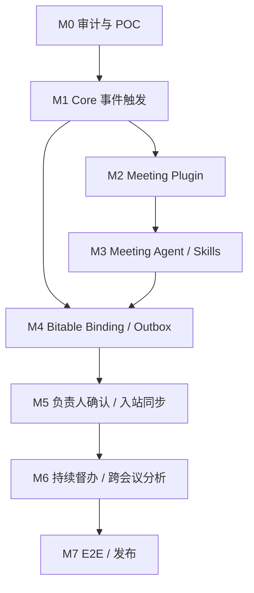

# agenteam.meeting 实施路线与验收标准

- 架构基线：[architecture-baseline.md](architecture-baseline.md)
- 状态：**计划已确认，尚未实施**
- 目标插件：agenteam.meeting
- 计划阶段：M0–M7
- 执行原则：每个阶段有独立交付物和验收证据；阶段完成后进行上下文压缩与差距复核，再进入下一阶段。不得为了“一次性完成”跳过架构审计、真实 API POC 或 CI。

---

## 1. 阶段总览

| 阶段 | 目标 | 主要交付 |
| --- | --- | --- |
| M0 | 全量架构审计与飞书 POC | 能力差距、API 权限矩阵、POC 报告、ADR 修订 |
| M1 | AgenTeam 通用事件触发基础设施 | Event Subscription、Inbox、Delivery Worker、Service Principal、Event-triggered Run |
| M2 | Meeting Plugin 与会议 API | agenteam.meeting JAR、会议只读 Tools、授权和工具测试 |
| M3 | Meeting Agent 与 Skills | 一个 Meeting Agent、meeting-intelligence、结构化输出和领域校验 |
| M4 | 统一 Bitable Binding 与同步 | 会议主表/督办宽表、Schema 校验、字段映射、Versioned Outbox |
| M5 | 负责人确认和入站同步 | 卡片投递、确认/调整/拒绝、Bitable 变更事件或对账 |
| M6 | 持续督办与跨会议分析 | 定时 Agent Run、逾期提醒、上游覆盖、异常跟进 |
| M7 | 全链路验收与正式发布 | 真实飞书 E2E、故障恢复、安全审计、Release |

---

## 2. M0 — 全量架构审计与 POC

### 目标

在生产代码实施前，验证目标架构能否依赖 AgenTeam 现有能力实现，明确必须改造的 Core 边界和飞书 API 风险。

### 工作项

- 对当前目标分支重新核对 JavaToolPlugin、插件清单解析、独立进程、Skill 版本冻结、Run 提交、Run Worker、Schedule、Feishu Connection、Webhook、Token Broker 和消息卡片实现。
- 审计 magic-ai 三个参考分支，整理会议领域资产、历史流程耦合和待迁移测试。
- 审计 ERP 产品研发宽表同步：Binding、字段白名单、转换器、执行日志、重试和回写。
- 验证飞书会议结束事件、Note/Minutes/Transcript API、用户授权 Scope、Bitable Schema/记录 API、卡片回调和记录变更事件。
- 设计 Event Subscription、Inbox、Delivery、Service Principal、Run 触发数据模型。
- 设计两张统一 Base 业务表和字段所有权矩阵。
- 完成权限威胁模型和失败恢复设计。

### 交付物

- 飞书 API / Scope / 事件类型验证报告。
- magic-ai 领域能力迁移清单。
- AgenTeam Core 架构差距清单。
- Event-triggered Run 数据模型草案。
- Bitable Binding / 字段映射 / Outbox 数据模型草案。
- POC 代码或可重复测试脚本（仅用于验证，不合入生产路径）。
- 必要 ADR 更新。

### 验收标准

- [ ] 真实飞书会议结束事件成功接收并验签。
- [ ] 明确事件 ID、会议 ID、事件版本和重复投递行为。
- [ ] 至少完成一次真实 Note / Minutes / Transcript 读取，并记录所需身份与权限。
- [ ] 明确 Bot 和 User Token 的权限差异及授权流程。
- [ ] 真实 Base 能读取 Schema、按稳定键查询、创建和更新记录。
- [ ] 明确 Bitable 记录变更事件是否可用；不可用时给出对账方案。
- [ ] 明确卡片回调可验证操作者和事件唯一性。
- [ ] 明确 service principal 的持久化、权限、配额和审计方案。
- [ ] 所有未验证项有负责人、风险和后续决策，不以假设冒充验证结果。

**阶段门禁：** M0 未通过，不开始 M1 生产代码实施。

---

## 3. M1 — AgenTeam 通用事件触发基础设施

### 目标

让任意可信插件可以声明事件能力，并由 Core 安全、可靠地把外部事件转化为标准 Run。此阶段不实现会议业务语义。

### 工作项

1. 定义版本化 Plugin Event Subscription 声明及安装时校验。
2. 增加企业级 Event Subscription 资源及管理接口。
3. 将 Feishu 事件接收从 Chat 专属业务处理中抽象出通用 Event Adapter。
4. 建立 Event Inbox 和 Event Delivery 持久化表、唯一索引和保留策略。
5. 建立租约领取、重试、退避、死信/人工恢复和事件 ACK 语义。
6. 增加企业级 Service Principal / Trigger Principal，不冒充普通用户。
7. 增加 EventTriggeredRunService，复用 RunSubmissionService / RunWorker / Agent Runtime。
8. 在 Run 和审计中记录 trigger、subscription、source event、service principal 和 initiating admin。
9. 事件触发执行纳入原有 Token 用量、并发限制和企业配额。
10. 提供订阅停用、暂停、恢复、删除保护和执行历史查询。

### 验收标准

- [ ] 插件可声明事件类型，但插件进程不常驻。
- [ ] 未安装、未启用或版本不匹配的订阅不会触发 Run。
- [ ] 相同 event_id 重复投递只生成一条 Inbox。
- [ ] 同一事件匹配多个订阅时，每个订阅最多生成一个 Delivery。
- [ ] Worker 崩溃后租约到期可重新领取。
- [ ] 事件只有在持久化成功后才 ACK。
- [ ] 事件触发 Run 的身份为 service principal，不冒充主持人或管理员。
- [ ] service principal 只能调用已授权工具和资源。
- [ ] Token 使用量进入标准 Run 计量和企业用量统计。
- [ ] 订阅暂停后不再创建新 Run，已有 Run 按明确策略处理。
- [ ] 多实例竞争领取不会重复执行同一 Delivery。

---

## 4. M2 — agenteam.meeting Java Plugin

### 目标

将会议读取和领域规范化能力封装成可安装的无状态 Java 工具插件。

### 工作项

- 建立独立 Maven 插件工程和标准 JAR 清单。
- 实现 JavaToolPlugin，工具定义稳定、参数 Schema 严格。
- 实现 meeting_search、meeting_get、minutes_get、transcript_get、meeting_people_resolve、meeting_artifact_status。
- 对接 Core Credential Broker，使用当前企业和授权主体对应的短期凭据。
- 保留 magic-ai 的会议资料解析、参与人映射和证据锚点规范化逻辑。
- 增加 API 超时、分页、速率限制、错误分类和敏感字段脱敏。
- 不在插件内创建数据库、Redis、WebSocket、线程池或长期任务。

### 验收标准

- [ ] 插件包可通过 AgenTeam 现有安装检查。
- [ ] 插件工具可被 Agent 发现并按选择结果调用。
- [ ] 每次工具调用结束后插件进程可被终止，不影响下一次调用。
- [ ] 会议资料读取严格使用已绑定企业和授权主体。
- [ ] 参数无法覆盖 enterprise_id、actor_id、credential、app_token 或 table_id。
- [ ] 纪要和逐字稿解析支持空值、分页、超时和异常响应。
- [ ] 日志和 Tool Result 不包含 Token、App Secret 或完整敏感逐字稿。
- [ ] 插件单测覆盖正常、权限不足、授权过期、限流和超时场景。

---

## 5. M3 — Meeting Agent 与 Skills

### 目标

使用 AgenTeam 原生 Agent Runtime 完成会议理解和任务识别，不再把旧流程阶段迁移成固定工作流。

### 工作项

- 创建一个 Meeting Agent 版本，固定声明 Meeting Plugin 和 Core Bitable / 通知工具依赖。
- 创建 meeting-intelligence Skill，拆分分类、证据、负责人、去重、上下游覆盖和发布规则。
- 创建结构化 Meeting Analysis 输出 Schema。
- 实现 Java MeetingResultValidator：校验证据、任务类型、负责人身份、来源、字段长度和不允许的事实推断。
- 任务分类保留 L1 / L2 / L3。
- Agent 在需要时自主选择 Note、Minutes、Transcript 和历史会议查询。
- 重新分析前查询已存在任务，匹配后复用 task_key。
- 保留 source_revision、analysis_version 和 Run 关联，支持审计和复现。

### 输出契约建议

```json
{
  "meeting": {
    "meetingId": "source meeting id",
    "sourceRevision": "artifact revision",
    "summary": "meeting summary"
  },
  "tasks": [
    {
      "candidateTitle": "task title",
      "classification": "L1",
      "evidence": {
        "source": "transcript",
        "anchor": "source segment or timestamp",
        "quote": "grounded evidence"
      },
      "suggestedOwner": {
        "openId": null,
        "displayName": null,
        "confidence": "unknown"
      },
      "suggestedDueDate": null,
      "deliverable": null,
      "acceptanceCriteria": null,
      "upstreamCandidates": []
    }
  ],
  "ignoredItems": [],
  "risks": []
}
```

模型输出是候选结果，不能直接成为事实。Core 生成 task_id/task_key，Validator 负责最终写入约束。

### 验收标准

- [ ] 一个 Meeting Agent 能完成会议分析，不依赖固定业务状态机。
- [ ] Run 冻结模型配置、Agent 版本和 Skill 版本。
- [ ] L1/L2 任务必须有证据；L3 不进入督办。
- [ ] 无依据的负责人和截止日期保持未知。
- [ ] 同名人员不能仅凭姓名自动确认身份。
- [ ] 同会重分析能识别已有任务并复用 task_key。
- [ ] 跨会议相似任务只建立候选关联，不自动错误合并。
- [ ] 结构化输出通过 JSON Schema 和 Java Validator。
- [ ] 模型失败不会产生部分成功的业务任务记录。

---

## 6. M4 — 统一 Bitable Binding 与可靠同步

### 目标

建立企业统一 Base 的两张业务表和通用投影链，替代每场会议独立创建 Base 的模式。

### 工作项

- 实现 MeetingBitableBinding 管理和权限校验。
- 创建会议主表、会议督办宽表的字段模板与版本化映射。
- 实现 Meeting Field Code 白名单和显式类型转换。
- 实现 Schema 读取、兼容性校验、只读字段识别和 Schema Fingerprint。
- 实现 meeting_key / task_key 查询、Upsert 和版本保护。
- 实现 Versioned Outbox、租约 Worker、指数退避、结果未知对账和人工重试。
- 实现字段所有权策略，禁止 AI 覆盖人工确认字段。
- 建立同步状态、失败原因和最近成功版本的可观测性。

### 验收标准

- [ ] 一个企业只绑定一个活动会议 Base。
- [ ] Base 内只有会议主表和会议督办宽表两张首期业务表。
- [ ] Binding 不允许模型任意指定 app_token/table_id。
- [ ] 必需字段、唯一键和字段类型在绑定时校验。
- [ ] 相同 meeting_key/task_key 重复提交不会重复创建记录。
- [ ] 同一任务的旧版本不能覆盖新版本。
- [ ] 飞书写入失败只重试 Outbox，不重跑模型分析。
- [ ] 外部写入结果未知时先查询远端稳定键，不盲目重放 create。
- [ ] 人工维护字段不会被 AI 重分析覆盖。
- [ ] Schema 变更会阻止不兼容写入并给出明确错误。
- [ ] 同步日志能区分待处理、执行中、成功、失败和待核对结果。

---

## 7. M5 — 负责人确认与入站同步

### 目标

让飞书成为任务确认和执行状态的唯一业务事实来源。

### 工作项

- 建立通用 Feishu Card Delivery Port 和可恢复通知 Outbox。
- 设计任务确认卡片：确认、调整、拒绝。
- 建立签名回调路由，校验企业、操作者、task_key、record_id、expected_version 和 event_id。
- 将确认状态、负责人意见和人工修改字段写回督办宽表。
- 验证 Bitable 记录事件；若不可用，提供可配置周期对账。
- 入站事件消费时 GET 最新记录，按字段所有权应用变更。
- 调整意见进入 Meeting Agent，产生修订建议并重新确认。
- 对旧卡片、重复点击和并发修改提供冲突提示。

### 验收标准

- [ ] 只有负责人或被授权角色能执行对应操作。
- [ ] 旧版本卡片不能覆盖新版本记录。
- [ ] 重复回调不会重复执行状态迁移。
- [ ] 拒绝和调整都有审计记录。
- [ ] Agent 修订不会静默覆盖人工字段。
- [ ] Bitable 直接编辑可以通过事件或对账进入系统。
- [ ] 飞书宽表显示的任务状态与系统读取结果一致。

---

## 8. M6 — 持续督办与跨会议分析

### 目标

让会议 Agent 从“会议结束时分析一次”扩展到持续追踪承诺与执行情况。

### 工作项

- 创建 meeting-follow-up Skill。
- 使用 AgenTeam Schedule / 受控事件触发能力定期启动企业级 Meeting Agent Run。
- 查询待确认、临近截止、逾期、阻塞和长期未更新任务。
- 查询上游会议承诺和下游会议覆盖情况。
- 对缺失覆盖、重复承诺、责任不清和截止日期冲突生成风险项。
- 按订阅配置向负责人和战略中心推送摘要。
- 支持企业管理员暂停、恢复和调整跟进频率。

### 验收标准

- [ ] 定时任务使用 service principal 和明确企业权限。
- [ ] 同一时间窗口不会重复发送相同提醒。
- [ ] 逾期判断使用企业时区和 Base 当前截止日期。
- [ ] 上游覆盖分析能提供源会议和源任务证据。
- [ ] Agent 不擅自修改负责人确认的截止日期。
- [ ] 提醒、汇总和复核有 Run 与消息投递记录。
- [ ] 管理员可以暂停跟进且不会删除业务数据。

---

## 9. M7 — 全链路验收与正式发布

### 目标

在真实飞书企业应用和真实会议数据上完成端到端验收，达到可长期运行的质量标准。

### 必须覆盖的 E2E

1. 会议结束事件正常接收。
2. 重复事件只创建一个有效事件投递。
3. Note / Minutes 延迟生成后可以自动恢复。
4. 授权过期后不会借用其他用户身份。
5. Meeting Agent 读取资料并输出 L1/L2/L3 分类。
6. 任务证据能定位到纪要或逐字稿。
7. 同一会议重分析不会重复创建任务。
8. 一场会议无 L1/L2 任务时仍保留会议主表记录。
9. 任务成功写入统一督办宽表。
10. Bitable 写入成功但响应丢失时不会重复创建。
11. 负责人确认、调整和拒绝均正确回写。
12. 旧卡片回调被拒绝。
13. 飞书 Base 人工修改能被入站事件或对账发现。
14. 上游任务未覆盖时能被跨会议 Agent 发现。
15. Outbox Worker 中断后可恢复。
16. Event Worker / Feishu Connection 重启后可恢复。
17. Run 取消、超时和工具权限失败均有审计。
18. 企业额度、Token 统计和并发限制正确。

### 发布门禁

- [ ] Backend CI 全绿。
- [ ] Frontend CI 全绿（若涉及管理界面）。
- [ ] Playwright E2E 全绿（若涉及管理界面/卡片管理 UI）。
- [ ] 插件包可独立构建、安装、升级和卸载。
- [ ] 数据库迁移在空库和已有库升级场景通过。
- [ ] 真实飞书 Smoke 测试通过，未执行项明确标记为已知风险。
- [ ] 日志、凭据、权限和租户隔离审计通过。
- [ ] 架构文档、Skill 文档、插件开发文档和运维文档同步。
- [ ] PR 审核完成后再合并；发布 Tag / Release 与仓库当前版本策略一致。

---

## 10. 跨阶段测试矩阵

| 场景 | 预期结果 | 主要阶段 |
| --- | --- | --- |
| 同一会议结束事件重复到达 | Inbox 唯一约束阻止重复投递 | M1 |
| 两个 Worker 同时领取同一事件 | 只有一个租约有效 | M1 |
| 会议资料尚未就绪 | 延迟重试，不创建重复业务任务 | M1–M3 |
| 授权用户与会议主持人不同 | 按授权主体访问，不冒充主持人 | M0–M2 |
| 同名参会人 | 不自动误认负责人 | M2–M3 |
| 任务没有截止日期 | 保持空值，不由模型猜测 | M3 |
| L3 日常事项 | 不进入督办宽表 | M3 |
| 同一会议重复分析 | 复用原 task_key | M3–M4 |
| 飞书字段被改名或类型变化 | Schema 校验失败并阻止错误写入 | M4 |
| Bitable API 超时且结果未知 | 按 task_key 对账后恢复 | M4 |
| 人工已确认负责人，Agent 再分析 | 不覆盖人工确认字段 | M4–M5 |
| 负责人重复点击卡片 | 回调幂等，无重复状态迁移 | M5 |
| 非负责人操作卡片 | 拒绝并记录审计 | M5 |
| 飞书 Base 直接修改任务状态 | 入站事件/对账发现并读取最新快照 | M5 |
| 上游任务未被下游会议覆盖 | 产生有证据的覆盖风险 | M6 |
| 服务重启 | Inbox / Delivery / Outbox 租约恢复 | M1、M4 |
| Bitable 投影失败 | 只重试同步，不重新消耗模型分析 | M4 |
| Token 预算耗尽 | 触发受控阻断，不绕过企业配额 | M1–M7 |

---

## 11. 实施顺序与依赖



M2 与 M4 的部分设计可以并行，但生产集成必须满足 M1 的事件与身份基础、M3 的结构化输出契约和 M4 的 Binding / Outbox 约束。不能先让 Agent 直接写飞书，再补幂等与权限。

---

## 12. 上线与运维要求

- 按企业启用订阅，默认关闭；管理员完成应用授权和 Base Binding 后显式启用。
- 支持暂停单个订阅、暂停全部会议处理和恢复。
- 对 Event Inbox 堆积、失败重试、Outbox 延迟、Token 预算和 Feishu API 错误率提供指标。
- 保留事件 ID、Run ID、meeting_key、task_key、outbox ID 之间的关联追踪。
- 不在普通日志中记录完整逐字稿、用户 Token、App Secret 或完整敏感卡片内容。
- 对会议资料、事件快照和任务证据设置加密、访问审计和保留期限。
- 对外部写入结果未知提供人工核对入口；不能通过无限重试掩盖不确定状态。
- 版本升级时固定插件版本、Agent 版本、Skill 版本和 Binding 映射版本，支持逐企业灰度。

---

## 13. 完成定义

agenteam.meeting 只有在以下条件全部满足时才视为正式完成：

1. 真实飞书会议事件可以稳定触发 AgenTeam Run。
2. 会议资料读取权限和授权主体明确、可审计。
3. Meeting Agent 能基于真实资料完成有证据的任务分析。
4. 会议和任务写入企业统一 Base 的两张表。
5. 任务状态只有一个权威来源，不存在影子任务库。
6. 负责人能完成确认、调整、拒绝和执行状态维护。
7. 跨会议上游覆盖和逾期跟进可以持续运行。
8. 事件、Run、Outbox、卡片和入站同步均具备幂等与恢复机制。
9. Token 用量、权限和企业隔离沿用 AgenTeam Core。
10. M7 的自动化测试、真实飞书 E2E、代码审核和文档门禁全部通过。

当前状态：**M0 尚未启动；架构基线已确认。**
